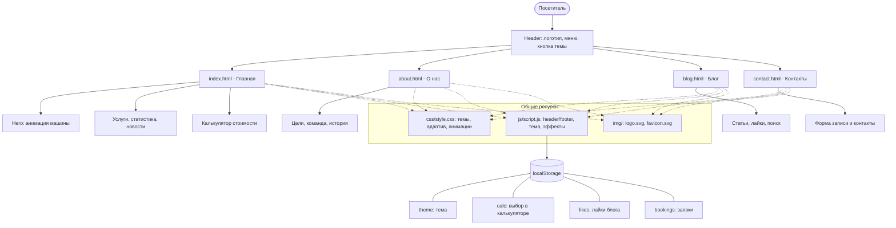
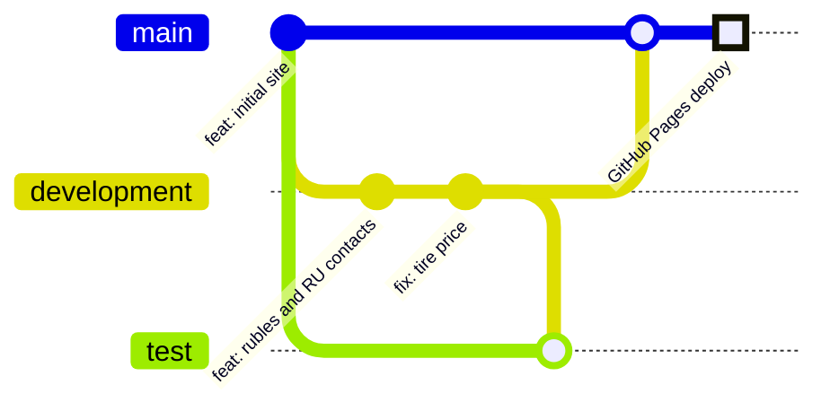

# 🔧 TurboGarage — сайт-визитка автосервиса

Статический сайт на HTML5 + CSS3 + JavaScript (без фреймворков), размещается на GitHub Pages.

## 🚀 Функциональность
- [x] Адаптивный дизайн (телефон, планшет, ПК), бургер-меню
- [x] Тёмная/светлая тема (запоминается в localStorage)
- [x] Анимации: езда машины, появление заголовка, счётчики, бегущая строка, свет за курсором
- [x] Калькулятор стоимости (localStorage)
- [x] Лайки и поиск в блоге (localStorage)
- [x] Форма записи, заявки сохраняются в localStorage
- [x] Учитывается `prefers-reduced-motion`

## 📁 Структура
```
index.html  about.html  blog.html  contact.html
css/style.css   js/script.js   img/ (logo, favicon)
```

## 🗺️ Диаграммы проекта

### Структура сайта и работа скрипта



### Git-ветки и деплой



## 🌿 Git-ветки
`main` — стабильная версия · `development` — разработка · `test` — эксперименты

## 🌐 GitHub Pages
`https://lokifarm13.github.io/static-site_work/` — Settings → Pages → Branch `main`, папка `/ (root)`.

## 📄 Лицензия
MIT
